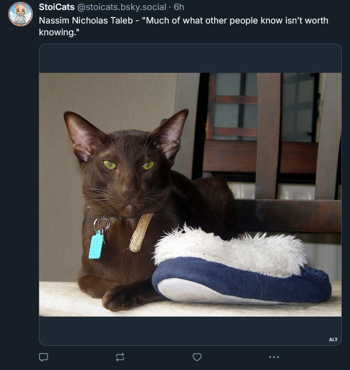
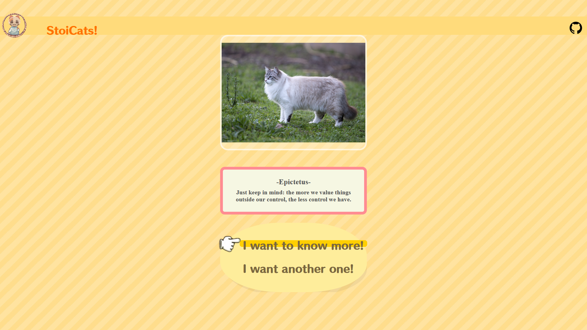
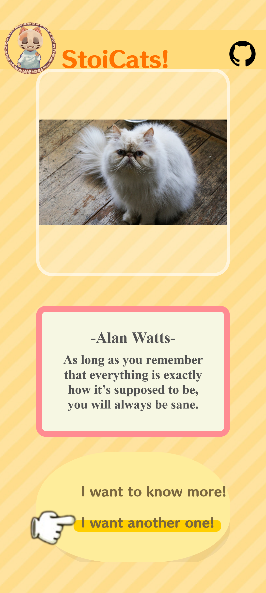

# stoicats 

`Stoicats` é um projeto que mescla citagens estóicas com fotos muito fofinhas de gatinhos. Há dois submódulos para os bots dentro do repositório do projeto. Um bot faz postagens no `X` (antigo twitter) e o outro no `BlueSky`. Há outro submódulo para um `aplicativo frontend`.

# Bots

## BlueSky

Aqui está um exemplo de um bot funcionando no bluesky:

Foi feito com `TypeScript` (node.ts) e roda em um "cor job" usando o `Github Actions`.
Para mais informações (como rodar, documentação), vá para o respectivo [repositório](https://github.com/AndreAnimator/stoicats-bsky.git).

## Twitter

Progresso em andamento.

# App

Aqui está um exemplo do aplicativo rodando no desktop:

Aqui está um exemplo do aplicativo rodadno no mobile:

Foi feito usando `Ionic` e `Angular`.
Para mais informações, consulte seu [repositório](https://github.com/LorenzoPilati/Stoicats.git).
